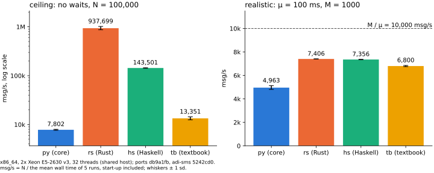

# adi-sms-ports

Rust and Haskell restatements of [adi-sms](https://github.com/Jesssullivan/adi-sms)'s fate and fold, and a textbook
Python and TypeScript version of the brief, each checked byte for byte against the core's `sms fold`.

- `rust/` and `haskell/` are the ports, `textbook/` is the plain MT19937 / TinyMT32 simulation, `bench/` holds the receipts.
- `nix develop -c just check` runs what CI runs: the conform rows on 1, 2 and 8 threads, the streams row and the textbook.
- `nix run github:Jesssullivan/adi-sms-ports#sms-rs -- --n 1000` (or `#sms-hs`) runs a port.
- How AI tools were used: [AI.md](AI.md).

Left: no waits, so the CPU cost per message sets the rate (log scale). Right: 1000 senders each wait a mean 100 ms per message, so time in flight, not the language, sets the rate under the 10,000 msg/s cap. Receipt: [bench/results/xlang.json](bench/results/xlang.json).

> Upon completing the functional specification, I thought it'd be fun to point claude at this to reimplement in Rust and Haskell and expand + create multithread executables, from which I have established and published fold operation benchmarks against my python implementation; find them here, checked byte for byte against sms fold.

> In defense of my humanity, I (like everyone else) am gaining comfort writing, reading and reviewing Rust code.  I felt it would be best to stick with Python throughout the development, exploration and solution to this problem for my own confidence, ability to communicate and the ability to work through the establishment of the functional model with familiar PBT packages (in my case, working in parallel with Haskell / QuickCheck and Python / Hypothesis from a central Dhall expression. 

### Regarding the above, Gabriella Gonzalez (author of the Dhall language, among many other cool things) wrote a brief blog post relating to this stance on use of code generation with LLMs https://haskellforall.com/2026/03/a-sufficiently-detailed-spec-is-code
